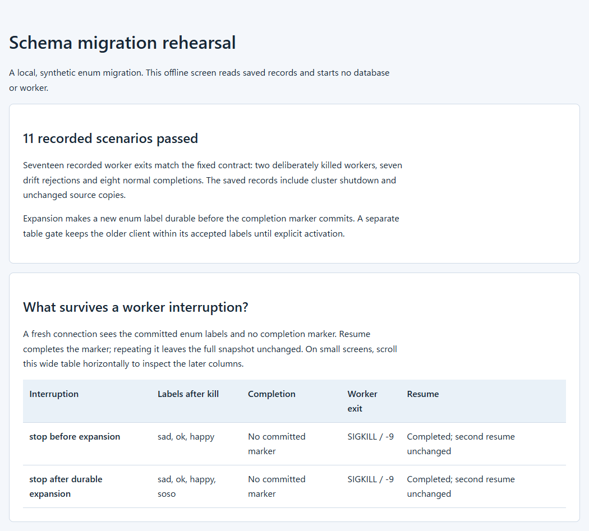

# Schema Migration Rehearsal

Rehearse an interrupted PostgreSQL enum change and inspect when an older client stops being compatible. The example runs real PostgreSQL workers through Alembic's autocommit boundary, keeps a compatibility gate until explicit activation, and records what survives a forced worker termination.

## See the result



The [offline report](examples/current/report.html), [terminal summary](examples/current/summary.txt) and [review JSON](examples/current/review.json) show the recorded outcome. GitHub displays HTML source: clone the repository, or download the files into the same directory and open `report.html` locally.

The fixed contract contains **11 scenarios and 17 worker exits**:

- Kill a worker before expansion, or after the enum label is durable but before its completion marker commits. A fresh connection observes what remained; resume completes the marker, and a second resume changes nothing.
- Keep old-label reads and writes working while the gate rejects the new label with SQLSTATE `23514`.
- Reject seven kinds of schema, data or marker drift before the migration executes.
- Explicitly activate the new label and observe the unchanged old reader reject it. This expected incompatibility marks the limit of the compatibility window.

The report starts no database. It checks the saved adapter record, raw worker records, preserved source copies, expected case outcomes and recorded cleanup. Missing or contradictory evidence cannot count as an overall pass.

## Try on Linux

Use a non-root Linux x86_64 account, **CPython 3.12.3**, **PostgreSQL 18.6**, matching development headers and a C compiler. The [Linux guide](docs/LINUX.md) covers prerequisite checks, an optional user-local PostgreSQL source build, preparation, repeated runs and failures. No system database or production connection is used.

The [operation walkthrough](docs/OPERATIONS.md) includes an executable first-use/repeat example, terminal inspection, result interpretation, failure diagnosis and explicit cleanup of a stopped run. With the prerequisites available, create an empty native Linux work parent, then use:

```sh
mkdir "$HOME/schema-demo"
bash examples/linux-demo.sh /usr/bin/python3.12 \
  "$HOME/.local/opt/postgresql-18.6/bin" "$HOME/schema-demo"
```

From the checkout, select the existing executables and a new, absent environment directory on a native Linux filesystem:

```sh
SCHEMA_PYTHON=/usr/bin/python3.12
SCHEMA_PG_BIN="$HOME/.local/opt/postgresql-18.6/bin"
SCHEMA_ENV="$HOME/schema-migration-environment"

"$SCHEMA_PYTHON" -B tools/sandbox.py doctor \
  --python "$SCHEMA_PYTHON" --pg-bin "$SCHEMA_PG_BIN" \
  --output-parent "$HOME"

"$SCHEMA_PYTHON" -B tools/sandbox.py prepare \
  --python "$SCHEMA_PYTHON" --pg-bin "$SCHEMA_PG_BIN" \
  --work-dir "$SCHEMA_ENV"

"$SCHEMA_PYTHON" -B tools/sandbox.py run \
  --environment "$SCHEMA_ENV" --output-parent "$HOME"
```

`doctor` checks prerequisites without creating files or making network requests. `prepare` acquires 26 artifacts through fixed official URLs and verifies their hashes, builds psycopg2 in a separate environment, then installs the recorded dependencies offline into a fresh runtime. An existing output directory is refused.

`run` invokes the unchanged contract adapter once in a new private directory. Open the printed `report/report.html`, or read its sibling `summary.txt`; keep `review.json` beside the HTML. Reinspect the printed `run` path with `python3.12 -B tools/report.py --run /exact/run/path`; this writes nothing. Run again to obtain a separate rehearsal. Raw receipts and logs stay in the new run directory and may contain machine paths and local connection details; inspect them before sharing.

## Implementation and verification

The preparation command, isolated runtime wrapper, offline report and focused safety checks are the authored additions. The existing migration runtime, SQL fixtures, worker and contract harness remain unchanged. [Verification](VERIFICATION.md) distinguishes the original baseline, dependency preparation, actual runtime observations and checks of saved records. [Research notes](RESEARCH.md) relate the compatibility and resume questions to the F1 schema-change paper without claiming to implement F1's distributed protocol.

## Limits

This is one fixed schema, one coordinator, synthetic data and one closed-set client. Worker SIGKILL does not test power loss. Adding an enum label and committing its completion marker are separate durability boundaries. There is no enum removal, arbitrary migration input, concurrent schema-writer support, distributed rollout or zero-downtime guarantee. The records are editable and unauthenticated; this report does not prove current service health or production readiness.

## Repository map

| Path | Purpose |
| --- | --- |
| [tools/sandbox.py](tools/sandbox.py) | Read-only doctor, isolated dependency preparation and one-command run |
| [tools/report.py](tools/report.py), [tests](tests) | Offline record inspection and focused safety/corruption tests |
| [rehearsal](rehearsal) | Fixed SQL, migration worker and retained contract harness |
| [components/alembic](components/alembic) | Preserved migration implementation and upstream tests |
| [examples/current](examples/current), [examples/linux-demo.sh](examples/linux-demo.sh), [docs/OPERATIONS.md](docs/OPERATIONS.md), [docs/LINUX.md](docs/LINUX.md) | Recorded result, runnable walkthrough and Linux operations |
| [requirements.lock](requirements.lock), [requirements.official-artifacts.hashed.lock](requirements.official-artifacts.hashed.lock) | Accepted version profile and selected official artifacts |
| [verification](verification), [source-copy-manifest.json](source-copy-manifest.json) | Scoped observations, source hashes and historical evidence |

[Security and problem reporting](SECURITY.md) covers local-data boundaries. [PROVENANCE.md](PROVENANCE.md), [NOTICE](NOTICE), [LICENSE](LICENSE) and [LICENSE.authored](LICENSE.authored) retain the source, derivation and license boundaries.
